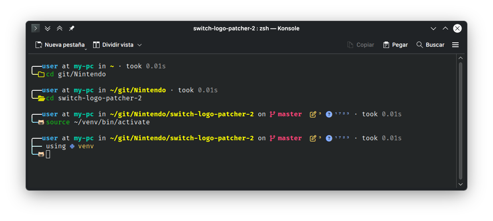
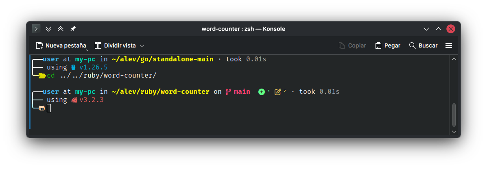
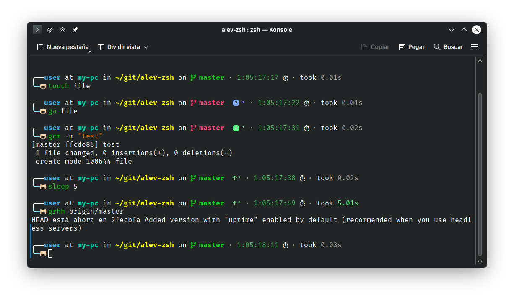
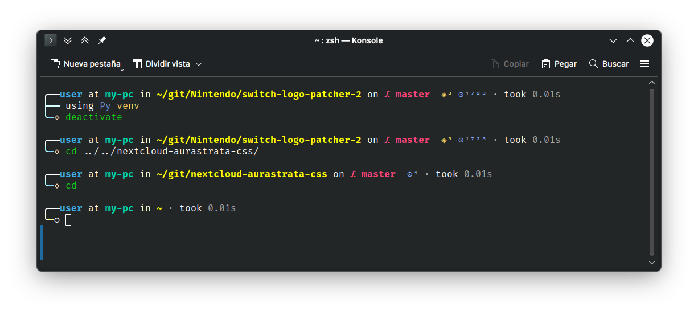

# Ale-Evolved (Alev) ZSH Theme

This theme is based in the [alepimentel's ale](https://github.com/alepimentel/ale-zsh) theme.

---

~5 years of tweaking the original theme as I pleased + 3 hours fixing the half dead spaghetti mess I left with ChatGPT.

---

What does it show?
------------------
- User and hostname.
- Current working directory with path shortening.
- Current Git branch, exact tag or abbreviated commit hash in detached HEAD state.
- Git working tree status (clean or dirty).
- Git counters for ahead and behind commits, staged changes, conflicts, modified, deleted and untracked files.
- Command execution time.
- Non-zero exit codes.
- ASCII support
- Dedicated indicators for root users and SSH connections.
- Active virtual environments and programming language versions (as far as I could).

Features
--------

- Automatic color depth detection and fallback
- Automatic ASCII fallback on basic terminals.
- Intelligent path shortening.
- Automatic wrapping of language and environment indicators.
- Colored stderr output.
- Built-in visual previews and diagnostic functions.
- "Uptime" variant. More convenient for headless servers. Servers in general.

### Nerd Font version

### Nerd Font with uptime version

### Unicode (base) version

### ASCII fallback version

Compatibility
-------------
- The theme is meant work with [Oh My Zsh](http://ohmyz.sh)

Dependencies
------------

- Zsh
- [Oh my Zsh](https://ohmyz.sh/)
- Opcional: [Nerd Fonts](https://www.nerdfonts.com/) to have the nice icons.

Installation
------------
1. Put the `*.zsh-theme` files inside the `~/.ohmyzsh/custom/themes/`
2. Edit the the `ZSH_THEME` variable to the name of the theme in your `~/.zshrc` file
    1. `ZSH_THEME="alev"` ⟶ Unicode. Recommended for dark terminal backgrounds.
    2. `ZSH_THEME="alev-light"` ⟶ Unicode. Recommended for light terminal backgrounds.
    3. `ZSH_THEME="alev-nf"` ⟶ Nerd font support. Recommended for dark terminal backgrounds (as God intended)
    4. `ZSH_THEME="alev-nf-font"` ⟶ Nerd font support. Recommended for light terminal backgrounds.
    5. `ZSH_THEME="alev-nf-uptime"` ⟶ Nerd font support and uptime info. Recommended for dark terminal backgrounds.

Either that or copy one and tinker with the following variables in any file:
- `_ALEV_DARK_THEME` (`true`, `false`)
- `_ALEV_ICON_MODE` (`unicode`, `nf`, `ascii`)
- `_ALEV_UPTIME_ENABLED` (`true`, `false`)

Notes
-----
- Left some debugging functions inside (just for fun). Use the `_alev_help` to see everything. 
- Most of the things can be toggled on or off via the variables at the top of the `.zsh-theme` file.

